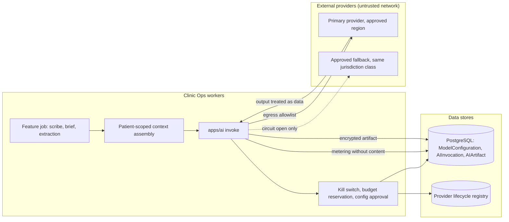

# Threat model: AI gateway

- Status: design baseline, 2026-09-24 (todo 2). Mitigations are planned work
  owned by the listed todos unless a current source path is named. The Tests
  column maps each mitigation id to the tests that prove it (todo 73,
  checked by `tests/infra/test_threat_model_coverage.py`). A mitigation that
  starts with **Proposal:** goes beyond the owning todo's plan text; that
  todo accepts or rejects it and isn't bound by it until then.
- Decisions: [ADR-006](../adr/ADR-006-ai-gateway-routing.md),
  [ADR-007](../adr/ADR-007-deterministic-retrieval.md),
  [ADR-014](../adr/ADR-014-observability-redaction.md)

## Scope

Every model call made by Clinic Ops: speech recognition, drafting, briefs,
extraction, front desk, analyst and decision support. Covers `apps/ai`
configuration, invocation, metering, budgets, kill switches, egress and the
provider adapters. Tool execution by agents is in [agents](agents.md).

## Assets

- Prompt inputs assembled from the chart (PHI).
- Model outputs stored as encrypted artifacts.
- Provider credentials and approved model configurations.
- Organization budgets and metering records.
- Kill-switch state.

## Trust boundaries

1. Feature code to the gateway (inside the app, trusted caller).
2. Gateway to the provider lifecycle registry and owner-written configuration.
3. Gateway adapters to external providers over the network.
4. Provider responses back into the app (untrusted content).

## Data flow

## Threats and mitigations

| ID | STRIDE | Threat | Mitigation | Todos | Tests |
| --- | --- | --- | --- | --- | --- |
| AG-S1 | Spoofing | A fake or unapproved endpoint receives prompts. | Adapters send only to allowlisted hosts from an approved `ModelConfiguration`; the provider must be `activated` in the lifecycle registry. | 4, 38 | `tests/ai/test_units.py::test_egress_refuses_every_unapproved_destination` `tests/ai/test_policy.py::test_non_synthetic_data_mode_never_runs_a_synthetic_provider` `tests/providers/test_capability_lifecycle.py::test_is_live_negative_matrix_and_runtime_gate_composition` |
| AG-S2 | Spoofing | Feature code calls a provider SDK directly and skips the gateway. | Provider adapters exist only as `ProviderProtocol` registrations in `apps/ai`, with the egress allowlist enforced in the adapter base; egress tests refuse non-allowlisted hosts. | 38, 49 | `tests/ai/security/test_egress.py::test_non_allowlisted_egress_never_reaches_a_network_operation` `tests/ai/security/test_egress.py::test_exact_synthetic_allowlist_is_a_live_positive_control` |
| AG-T1 | Tampering | A prompt template or model configuration changes without review. | Prompts are versioned in code and identified by sha256; configurations are owner-written and `clinic_app` can only SELECT them; changes need an eval run. | 38, 47 | `tests/ai/test_units.py::test_prompt_provenance_hashes_the_exact_versioned_bytes` `tests/ai/test_posture.py::test_runtime_cannot_write_global_terms_and_owner_cannot_delete_artifacts` `tests/ai/test_evaluation.py::test_configuration_activation_without_evaluation_is_refused` |
| AG-T2 | Tampering | Provider output is trusted as instructions or structured truth. | Outputs are validated against closed schemas and treated as untrusted data; schema failures are rejected. | 38, 49 | `tests/ai/test_units.py::test_extraction_output_is_a_closed_schema` `tests/ai/test_units.py::test_provider_output_refuses_malformed_adapter_result_fields` `tests/scribe/test_draft_runtime.py::test_decoded_provider_result_is_rejected_before_any_projection` |
| AG-R1 | Repudiation | Nobody can tell which model and prompt produced an artifact. | `AIInvocation` records purpose, config version, prompt hash, principal and status; provenance lives in `apps/ai`, not in audit payloads (D-18). | 38 | `tests/ai/test_gateway.py::test_fake_call_is_metered_once_and_all_content_stays_encrypted` `tests/ai/test_units.py::test_prompt_provenance_hashes_the_exact_versioned_bytes` |
| AG-I1 | Information disclosure | Prompts or outputs appear in logs, metrics or metering. | Metering stores counts, cost and latency only; allowlist redaction for logs and spans. | 11, 38 | `tests/ai/test_observability.py::test_gateway_logs_contain_neither_input_nor_output_content` `tests/subscriptions/test_metering.py::test_ai_completion_and_replay_meter_exactly_once_without_content` `tests/core/test_telemetry_redaction.py::test_span_channel_drops_all_phi_strings` |
| AG-I2 | Information disclosure | Data leaves the approved jurisdiction through fallback. | Fallback only to an approved configuration of the same jurisdiction class; no cross-region inference profiles. | 38 | `tests/ai/test_gateway.py::test_fallback_never_crosses_the_approved_jurisdiction` `tests/ai/test_gateway.py::test_unapproved_region_is_refused_at_configuration_load` `tests/ai/test_benchmark_report.py::test_foreign_fallback_cannot_silently_change_jurisdiction` |
| AG-I3 | Information disclosure | Context assembly pulls another patient's or tenant's data. | Assembly calls domain services with the caller's permissions; no shared index. | 7, 44, 49 | `tests/ai/security/test_chart_isolation.py::test_retrieval_never_borrows_foreign_clinic_authority` `tests/ai/security/test_chart_isolation.py::test_foreign_artifact_is_as_unreadable_as_an_unknown_one` `tests/ai/security/test_chart_isolation.py::test_injected_question_never_starts_an_unscoped_search` |
| AG-I4 | Information disclosure | Provider retains or trains on clinic data. | Retention and training terms are part of the configuration and approval record; real use waits on EG-2 and EG-5. | 4, 48 | `tests/ai/test_benchmark_report.py::test_missing_or_unverified_terms_are_ineligible` `tests/ai/test_posture.py::test_runtime_cannot_write_global_terms_and_owner_cannot_delete_artifacts` `tests/providers/test_capability_lifecycle.py::test_activate_without_approval_is_denied_by_trigger` |
| AG-D1 | Denial of service | One tenant's AI burst exhausts shared budget or queues. | Budget reservation under a per-organization lock before dispatch; per-tenant fairness on `ai-interactive` and `ai-batch`. | 9, 38 | `tests/ai/test_budgets.py::test_concurrent_reservations_cannot_overspend_one_organization` `tests/ai/test_agent_guards.py::test_fairness_defers_only_the_exact_agent_task_and_tenant` `tests/ai/test_gateway.py::test_budget_exhaustion_refuses_before_outbox_publication` |
| AG-D2 | Denial of service | A provider outage or slowness blocks clinical work. | Circuit breaker per configuration; every feature has a manual fallback; degraded-mode drills. | 38, 72 | `tests/ai/test_gateway.py::test_timeout_opens_only_its_circuit_and_preserves_manual_work` `tests/ai/test_posture.py::test_closed_circuit_can_reopen_without_losing_history` |
| AG-D3 | Denial of service | Cost runaway from loops or abuse. | Per-purpose and per-organization caps, kill switches checked on every call, usage metering tied to entitlements. | 38, 64 | `tests/ai/test_gateway.py::test_a_kill_switch_stops_the_next_queued_call` `tests/subscriptions/test_concurrency.py::test_raw_ai_insert_cannot_bypass_the_subscription_quota` `tests/subscriptions/test_metering.py::test_outstanding_reservations_consume_quota_before_dispatch` |
| AG-E1 | Elevation of privilege | An organization admin enables a model or region the owner didn't approve. | Owner configures models; org admins can only opt in or out of approved configurations. | 38 | `tests/ai/test_controls.py::test_owner_cli_changes_only_synthetic_model_and_global_controls` `tests/ai/test_controls.py::test_org_admin_can_change_only_ai_fields_with_all_clinics_in_scope` |
| AG-E2 | Elevation of privilege | AI runs for an organization that never opted in. | Kill switches default ON: AI stays disabled until the organization opts in and enables the capability in `ClinicConfiguration`; the provider lifecycle and live-activation checks still apply after opt-in. | 38 | `tests/ai/test_policy.py::test_default_kill_switch_refuses_before_content_is_persisted` `tests/ai/test_decision_support.py::test_optional_panel_defaults_off_and_each_clinician_request_requires_opt_in` |

## Residual risk and external gates

- Model availability per region is unverified until EG-5 contracts and
  todo 48 benchmarks.
- Real AI use waits on EG-2; clinical AI waits on EG-3; performance claims
  wait on EG-11.
