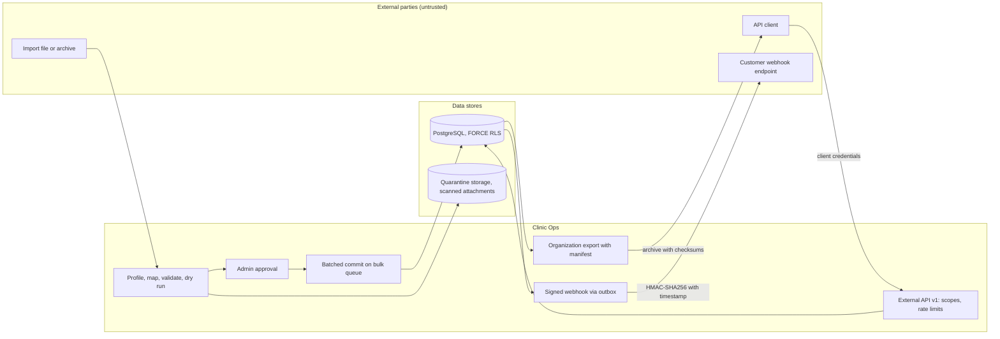

# Threat model: data import, export and external API

- Status: design baseline, 2026-09-24 (todo 2). Mitigations are planned work
  owned by the listed todos unless a current source path is named. The Tests
  column maps each mitigation id to the tests that prove it (todo 73,
  checked by `tests/infra/test_threat_model_coverage.py`). A mitigation that
  starts with **Proposal:** goes beyond the owning todo's plan text; that
  todo accepts or rejects it and isn't bound by it until then.
- Decisions: [ADR-017](../adr/ADR-017-additive-migrations.md),
  [ADR-015](../adr/ADR-015-isolation-encryption-search.md)

## Scope

Bulk import from other systems (CSV, XLSX, ZIP with attachments, API),
organization export and offboarding, the versioned external API
(`/api/v1/`) with OAuth2 client credentials, and signed outbound webhooks.
The existing retention export in `apps/retention` is the starting point for
organization export.

## Assets

- Whole-organization datasets in transit (the largest single exposure).
- Import provenance: original ids, authors and timestamps.
- API client secrets and webhook signing secrets.
- Attachments inside import archives (possible malware).

## Trust boundaries

1. Uploaded files into the import pipeline (untrusted content).
2. Import commit into tenant tables (bulk queue, fairness).
3. External API clients to `/api/v1/` (client credentials, no session).
4. Webhook deliveries to customer endpoints.
5. Export archives leaving the system.

## Data flow

## Threats and mitigations

| ID | STRIDE | Threat | Mitigation | Todos | Tests |
| --- | --- | --- | --- | --- | --- |
| IE-S1 | Spoofing | Imported notes appear written by the current clinician. | Imported records keep original author and timestamp as `imported` provenance and are never attributed to the importing user. | 66 | `tests/interop/test_import.py::test_provenance_keeps_original_author_and_time_never_the_importer` |
| IE-S2 | Spoofing | A stolen API secret calls the external API. | Secrets are hashed, rotatable and org-scoped; scopes limit resources; revocation is immediate. | 67 | `tests/interop/test_posture.py::test_runtime_role_holds_no_privilege_on_credential_digests` `tests/interop/test_external_api.py::test_revocation_rotation_and_approver_authority_take_effect_immediately` `tests/interop/test_external_api.py::test_scopes_bound_every_resource_and_malformed_tokens_are_identical` |
| IE-S3 | Spoofing | A receiver can't tell a real webhook from a forged one. | HMAC-SHA256 signatures with timestamp; receivers get documented verification steps. | 67 | `tests/interop/test_webhooks.py::test_booking_is_signed_and_delivered_through_the_action_outbox` `tests/interop/test_webhooks.py::test_reference_verifier_refuses_replays_tampering_and_malformed_headers` `tests/interop/test_webhooks.py::test_rotated_subscriptions_sign_with_both_secrets_during_overlap` |
| IE-T1 | Tampering | Malformed or hostile files corrupt data during import. | Deterministic validators (CPF, dates, units, codes), dry-run report, admin approval before commit, rejects listed with reasons. | 66 | `tests/interop/test_import.py::test_malformed_rows_are_rejected_with_row_level_reasons` `tests/interop/test_import.py::test_ten_thousand_patient_csv_dry_run_counts_reconcile` `tests/interop/test_authority.py::test_org_admin_prepares_and_signs_off_but_cannot_commit_identity` |
| IE-T2 | Tampering | Import merges patients automatically on demographic matches. | Duplicates route to human-adjudicated review; no auto-merge. | 18, 66 | `tests/interop/test_import.py::test_duplicates_route_to_human_review_and_never_merge` |
| IE-T3 | Tampering | Export archive is altered in transit or at rest. | Manifest with per-file checksums; the reconciliation report compares counts, bytes and checksums. | 66, 67 | `tests/interop/test_import.py::test_checksum_mismatch_fails_before_and_after_upload` `tests/interop/test_org_export.py::test_org_admin_export_is_complete_scoped_and_verifiable` |
| IE-R1 | Repudiation | An import or rollback can't be traced. | `ImportJob` state machine with audited transitions; rollback marks the batch superseded instead of deleting. **Unproved:** no mapped test asserts the audit rows of import transitions. | 66 | `tests/interop/test_authority.py::test_database_refuses_illegal_edges_stale_sequences_and_history_edits` `tests/interop/test_import.py::test_rollback_hides_batch_and_retains_used_patients` `tests/interop/test_authority.py::test_rollback_window_is_enforced_by_the_database` |
| IE-I1 | Information disclosure | Patient ids appear in API or webhook URLs. | Opaque external ids; record selectors never in URLs; delivery logs hold no PHI. | 67 | `tests/interop/test_external_api.py::test_foreign_and_unknown_external_ids_return_the_identical_404` `tests/interop/test_external_api.py::test_client_credentials_token_lists_appointments_with_opaque_ids` `tests/interop/test_webhooks.py::test_booking_is_signed_and_delivered_through_the_action_outbox` |
| IE-I2 | Information disclosure | The API exposes clinical narrative by default. | v1 scopes exclude clinical narrative unless a scope is approved. | 67 | `tests/interop/test_external_api.py::test_scopes_bound_every_resource_and_malformed_tokens_are_identical` `tests/interop/test_authority.py::test_import_authority_reads_metadata_but_never_clinical_payloads` |
| IE-I3 | Information disclosure | A full export reaches the wrong person. | **Proposal:** export requires org admin authority with step-up, and download links are short-lived and audited. | 67 | `tests/interop/test_org_export.py::test_export_needs_org_wide_authority_and_stops_once_it_is_lost` `tests/interop/test_org_export.py::test_expired_archives_keep_receipts_and_lose_their_bytes` `tests/interop/test_org_export.py::test_http_management_downloads_and_refuses_foreign_exports_alike` |
| IE-D1 | Denial of service | A large import starves chart saves for other tenants. | Commit runs in batches on the `bulk` queue with per-tenant fairness. | 9, 66 | `tests/interop/test_authority.py::test_bulk_fairness_defers_without_side_effects` `tests/core/test_fairness.py::test_concurrent_acquires_never_exceed_quota` |
| IE-D2 | Denial of service | API clients flood the service. | Redis token-bucket rate limits per client; idempotency key required on writes. | 67 | `tests/interop/test_external_api.py::test_rate_limit_answers_429_with_retry_after_until_refill` `tests/interop/test_external_api.py::test_writes_require_idempotency_keys_and_replay_exactly` `tests/interop/test_external_api.py::test_redis_lua_bucket_bursts_refills_and_isolates_clients` |
| IE-E1 | Elevation of privilege | A ZIP attachment carries malware into clinical storage. | Attachments are checksummed and scanned in quarantine before linking. | 66 | `tests/interop/test_sources.py::test_attachments_are_checksummed_and_scanned_in_quarantine` |
| IE-E2 | Elevation of privilege | An archive path escapes the extraction directory (zip slip). | Accepted by todo 66: archive entries must match the flat allowlisted `clinic-import-archive-v1` layout (no `..`, absolute, nested, symlinked or encrypted members) and are read in memory; nothing is extracted to disk. | 66 | `tests/interop/test_sources.py::test_archives_outside_the_flat_layout_are_refused` |

## Residual risk and external gates

- Competitor-specific import formats wait on EG-15 samples; no mappings are
  invented.
- Offboarding is revocation plus export, never user deletion (D-20).
