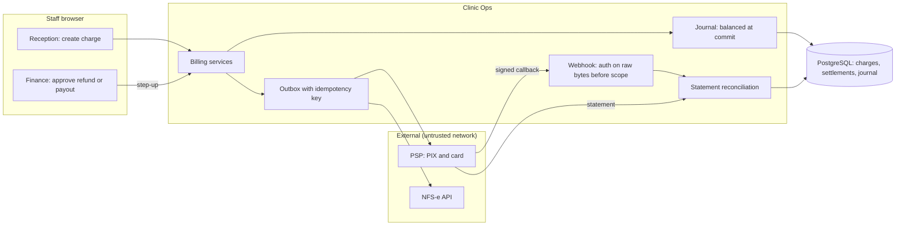

# Threat model: payments, journal and fiscal documents

- Status: design baseline, 2026-09-24 (todo 2). Mitigations are planned work
  owned by the listed todos unless a current source path is named. The Tests
  column maps each mitigation id to the tests that prove it (todo 73,
  checked by `tests/infra/test_threat_model_coverage.py`). A mitigation that
  starts with **Proposal:** goes beyond the owning todo's plan text; that
  todo accepts or rejects it and isn't bound by it until then.
- Decisions: [ADR-011](../adr/ADR-011-financial-journal.md),
  [ADR-008](../adr/ADR-008-workflows-and-approval-binding.md)

## Scope

Patient charges (PIX and card through a PSP), settlement callbacks, statement
reconciliation, refunds, payouts, cash close, the operational journal and
NFS-e fiscal documents. Clinic Ops' own SaaS subscription billing is in scope
only where it touches the same adapters.

## Assets

- Money movements: charges, settlements, refunds and payouts.
- Journal integrity (balance, single posting, immutability).
- PSP credentials and webhook secrets.
- Patient payment data kept by the PSP (card data never enters Clinic Ops).
- Fiscal documents and their authorization status.

## Trust boundaries

1. Staff browser to billing services (session, step-up for approvals).
2. Outbox worker to the PSP and NFS-e APIs.
3. PSP callbacks into the webhook endpoint (sessionless, D-19).
4. Statement import into reconciliation.

## Data flow

## Threats and mitigations

| ID | STRIDE | Threat | Mitigation | Todos | Tests |
| --- | --- | --- | --- | --- | --- |
| PY-S1 | Spoofing | A forged PSP callback marks a charge paid. | Callbacks are authenticated on raw bytes before any scope lookup (current pattern `apps/billing/reconciliation.py`); payload tenant claims are never read. | 57 | `tests/billing/test_psp_adapter.py::test_forged_raw_body_cannot_reach_scope_resolution` `tests/billing/test_psp_adapter.py::test_callback_ignores_payload_tenant_and_replay_converges` `tests/billing/test_psp_adapter.py::test_callback_signature_is_exact_raw_bytes_not_reencoded_json` |
| PY-S2 | Spoofing | A charge is marked paid when the QR code is created. | Paid state comes only from a verified settlement matched to a statement line. | 57 | `tests/billing/test_psp_adapter.py::test_charge_creation_is_pending_and_never_a_settlement` `tests/billing/test_psp_adapter.py::test_callback_disagreements_never_verify` `tests/billing/test_psp_reconciliation.py::test_verified_fixture_posts_gross_once_with_repasse_before_fees` |
| PY-T1 | Tampering | The callback amount differs from what was charged. | Reconciliation matches provider reference, amount and currency; mismatches go to quarantine. | 57 | `tests/billing/test_psp_adapter.py::test_statement_match_requires_all_three_exact_fields` `tests/billing/test_psp_statement.py::test_statement_disagreement_is_quarantined_with_its_actual_amount` `tests/billing/test_psp_reconciliation.py::test_amount_mismatch_is_retained_and_cannot_post` |
| PY-T2 | Tampering | A posted journal entry is edited. | Posted entries are immutable; corrections are linked reversals; a deferred trigger enforces balance. | 56 | `tests/billing/test_journal_posture.py::test_posted_entry_and_lines_cannot_be_changed_even_by_owner` `tests/billing/test_journal_posture.py::test_balance_triggers_are_actually_constraint_triggers_deferred_to_commit` `tests/billing/test_journal.py::test_unbalanced_entry_is_rejected_only_when_transaction_commits` `tests/billing/test_accounting_policy.py::test_partial_refund_reverses_entitlement_proportionally_with_lineage` |
| PY-T3 | Tampering | Rounding or splits create or lose cents. | Integer centavos, half-even rounding at versioned boundaries, largest-remainder allocation. | 56 | `tests/billing/test_journal.py::test_half_even_is_applied_at_the_versioned_reais_boundary` `tests/billing/test_journal.py::test_allocation_corpus_conserves_every_cent_and_uses_stable_remainders` `tests/billing/test_psp_policy.py::test_exact_money_boundary_rejects_non_centavo_inputs` |
| PY-R1 | Repudiation | Nobody can show who approved a refund or payout. | Refund and payout approvals need finance authority and step-up; approvals and transitions are audited. **Unproved:** no mapped test asserts the refund and payout transition audit rows. | 6, 56 | `tests/billing/test_cash_and_authority.py::test_finance_approval_does_not_inherit_legacy_manager_equivalence` `tests/billing/test_cash_and_authority.py::test_cash_close_has_zero_unexplained_balance_and_reopen_requires_persisted_step_up` `tests/billing/test_psp_refunds.py::test_replayed_refund_callback_requires_finance_and_reverses_repasse_once` `tests/billing/test_finance_views.py::test_step_up_commands_refuse_a_request_without_a_framework_session_key` |
| PY-I1 | Information disclosure | Card data or payment tokens leak into logs or outbox rows. | Card entry happens at the PSP; outbox rows and `last_error` hold no payment or patient data; PHI-sentinel scans. | 11, 57, 73 | `tests/billing/test_psp_adapter.py::test_card_link_uses_an_invalid_host_and_frozen_installments` `tests/billing/test_legacy_bridge.py::test_distinct_authenticated_provider_events_post_one_economic_fact` `tests/security/test_sentinel_sinks.py::test_request_sentinels_never_reach_any_sink` |
| PY-D1 | Denial of service | A PSP outage blocks reception. | Degraded mode keeps manual payment recording with clear status; no silent provider switch. **Unproved:** no mapped test drives a PSP outage and checks the clear reception status. | 57, 72 | `tests/billing/test_psp_adapter.py::test_provider_lookup_failure_is_unknown_not_permission_to_send` `tests/billing/test_psp_outbox.py::test_live_mode_cannot_fall_back_to_recorded_callback_processing` `tests/billing/test_legacy_bridge.py::test_first_legacy_receipt_prepares_missing_terms_and_commits_the_bridge` |
| PY-D2 | Denial of service | A failed SaaS subscription payment locks clinics out of records. | Restriction never blocks record access, export, reconciliation or continuity of care. | 64 | `tests/subscriptions/test_state.py::test_restricted_subscription_keeps_manual_notes_record_read_and_real_export` `tests/subscriptions/test_state.py::test_trial_expiry_cancel_offboard_never_deletes_records_or_memberships` |
| PY-E1 | Elevation of privilege | Reception approves its own refund. | Role matrix separates request and approval; refunds need finance approval. | 6, 56 | `tests/billing/test_cash_and_authority.py::test_finance_approval_does_not_inherit_legacy_manager_equivalence` `tests/billing/test_authority_census.py::test_financial_permission_roots_use_current_exact_clinic_authority` `tests/billing/test_psp_refunds.py::test_replayed_refund_callback_requires_finance_and_reverses_repasse_once` |
| PY-E2 | Elevation of privilege | A replayed or out-of-order callback posts twice. | Unique posting identity per economic fact; idempotent callback handling; replay tests. | 56, 57 | `tests/billing/test_journal_posture.py::test_duplicate_delivery_of_one_verified_collection_posts_once` `tests/billing/test_legacy_bridge.py::test_distinct_authenticated_provider_events_post_one_economic_fact` `tests/billing/test_accounting_policy.py::test_source_fact_replay_is_exact_and_different_content_is_refused` |
| PY-E3 | Elevation of privilege | A worker dies after the PSP moved money and a retry pays out twice. | Reservation before dispatch; retries reuse the provider idempotency key and look up status first. | 57, 72 | `tests/billing/test_psp_adapter.py::test_sigkill_after_remote_effect_recovers_without_a_second_create` `tests/billing/test_psp_outbox.py::test_remote_timeout_keeps_in_progress_and_redelivery_uses_lookup_only` `tests/billing/test_psp_policy.py::test_status_lookup_timeout_never_attempts_another_effect` |

## Residual risk and external gates

- Real PSP use waits on EG-1 and EG-5; NFS-e live issuance waits on EG-9.
- Tax classification is never guessed; the fiscal reviewer decides per clinic.
- Clinic Ops' own subscription collection waits on EG-18.
