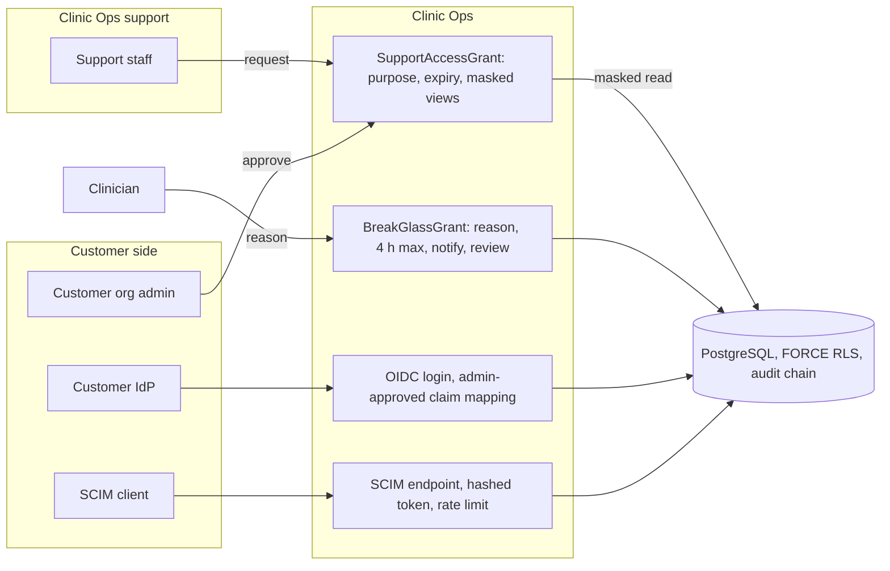

# Threat model: support access, break-glass and enterprise identity

- Status: design baseline, 2026-09-24 (todo 2). Mitigations are planned work
  owned by the listed todos unless a current source path is named. The Tests
  column maps each mitigation id to the tests that prove it (todo 73,
  checked by `tests/infra/test_threat_model_coverage.py`). A mitigation that
  starts with **Proposal:** goes beyond the owning todo's plan text; that
  todo accepts or rejects it and isn't bound by it until then.
- Decisions: [ADR-003](../adr/ADR-003-authorization-permission-bundles.md),
  [ADR-014](../adr/ADR-014-observability-redaction.md)

## Scope

Clinic Ops support staff reaching a customer tenant through just-in-time
grants, clinician break-glass access to a patient outside the care team, OIDC
single sign-on and SCIM provisioning. Database administration through
`clinic_super` is out of scope here; it's tests and admin only and covered by
[SECURITY.md](../SECURITY.md).

## Assets

- Tenant data seen by support staff.
- Records reached through break-glass.
- Role mappings from identity provider claims and SCIM groups.
- SCIM bearer tokens and SSO client secrets.

## Trust boundaries

1. Support staff to the tenant (customer admin approval required).
2. Clinician to an out-of-scope patient (break-glass reason and expiry).
3. Customer identity provider to Clinic Ops (OIDC).
4. SCIM client to the SCIM endpoint (sessionless, D-19).

## Data flow

## Threats and mitigations

| ID | STRIDE | Threat | Mitigation | Todos | Tests |
| --- | --- | --- | --- | --- | --- |
| SA-S1 | Spoofing | Support staff access a tenant without the customer knowing. | `SupportAccessGrant` requires customer admin approval, a purpose and an expiry; there's no universal support bypass. | 65 | `tests/identity/test_support_access.py::test_support_grant_requires_a_purpose_and_at_most_four_hours` `tests/identity/test_support_access.py::test_support_is_masked_and_purpose_bound` `tests/identity/test_support_access.py::test_jit_expiry_uses_a_clock_not_a_wait` `tests/identity/test_enterprise_inactive_actor.py::test_support_scope_and_raw_guard_refuse_an_inactive_named_actor` |
| SA-S2 | Spoofing | A forged or misconfigured IdP assertion logs in as a clinic user. | OIDC with discovery and PKCE per organization connection; claims map to roles only through admin-approved mappings. | 65 | `tests/identity/test_sso.py::test_approved_directory_subject_signs_in_without_a_factor_or_claim_elevation` `tests/identity/test_sso.py::test_oidc_state_is_single_use_and_bound_to_its_server_session` `tests/identity/test_sso.py::test_unmapped_subject_or_claim_cannot_elevate_a_role` |
| SA-S3 | Spoofing | A leaked SCIM token provisions users. | SCIM tokens are hashed, org-scoped, rate limited and revocable. | 65 | `tests/identity/test_scim.py::test_revoked_scim_token_is_unauthorized` `tests/identity/test_scim.py::test_scim_budget_refuses_past_one_hundred_then_revocation_is_unauthorized` `tests/identity/test_enterprise_nonstaff.py::test_scim_token_cannot_read_staff_patient_tables` `tests/interop/test_org_export.py::test_v3_exports_enterprise_records_but_never_a_scim_credential` |
| SA-T1 | Tampering | Support staff change clinical records. | Support principals never get clinical write; views are masked by default. | 65 | `tests/security/test_support_write_fence.py::test_clinical_write_is_refused_while_a_support_grant_is_in_context` `tests/identity/test_support_access.py::test_support_is_masked_and_purpose_bound` |
| SA-R1 | Repudiation | Break-glass use goes unreviewed. | Reason required, clinic manager notified at once, patient-visible access log entry, mandatory post-event review task. | 26, 65 | `tests/identity/test_break_glass.py::test_break_glass_without_reason_leaves_no_grant` `tests/identity/test_break_glass.py::test_break_glass_commits_manager_and_patient_notices_review_and_safe_audit` `tests/identity/test_emergency_views.py::test_patient_access_log_lists_the_emergency_read_without_its_reason` |
| SA-R2 | Repudiation | Support actions can't be tied to a person. | Every support grant and action is audited against the named support user and grant id. | 65 | `tests/security/test_audit_attribution.py::test_support_grant_and_read_are_audited_against_the_grant` `tests/identity/test_scim.py::test_provisioning_commits_audit_with_credential_principal` |
| SA-I1 | Information disclosure | Support sees more than the ticket needs. | Masked-by-default views. **Proposal:** unmasking is a separate, audited step inside the grant purpose. | 65 | `tests/identity/test_support_access.py::test_support_is_masked_and_purpose_bound` |
| SA-I2 | Information disclosure | Support diagnostics pull PHI into tickets. | Diagnostics use allowlisted telemetry and request ids, never payloads. | 11, 78 | `tests/identity/test_support_access.py::test_support_is_masked_and_purpose_bound` `tests/core/test_telemetry_redaction.py::test_log_channel_drops_all_phi_strings` `tests/core/test_telemetry_redaction.py::test_log_record_carries_request_id_from_context` |
| SA-D1 | Denial of service | A SCIM sync deprovisions every user by mistake. | Offboarding is revocation, never deletion (D-20), so a wrong deprovisioning can be undone; the SCIM endpoint is rate limited. | 15, 65 | `tests/identity/test_offboarding.py::test_offboarding_retains_user_and_membership_history` `tests/identity/test_scim.py::test_scim_budget_refuses_past_one_hundred_then_revocation_is_unauthorized` |
| SA-E1 | Elevation of privilege | IdP group claims grant admin roles automatically. | No automatic role elevation from claims without an approved mapping; bundles can't widen past professional scope. | 6, 65 | `tests/identity/test_sso.py::test_unmapped_subject_or_claim_cannot_elevate_a_role` `tests/identity/test_scim_bundle_issuer.py::test_modern_mapping_requires_owner_issuance_and_never_revokes_native_authority` `tests/identity/test_scim.py::test_approved_group_provisions_only_its_exact_unit_bundle` |
| SA-E2 | Elevation of privilege | Break-glass is used for non-clinical access or lasts indefinitely. | Break-glass is clinical only, scoped to patient or encounter, capped at 4 h. | 65 | `tests/identity/test_break_glass.py::test_break_glass_rejects_unbounded_or_elapsed_expiry` `tests/identity/test_break_glass.py::test_expired_break_glass_cannot_read_with_a_monkeypatched_clock` `tests/identity/test_break_glass_content.py::test_emergency_reader_returns_a_finalized_version_and_stops_on_revoke` |
| SA-E3 | Elevation of privilege | A revoked support or break-glass grant keeps working in an open session. | Grants are checked on every request; revocation closes realtime streams through the `authz:user:<id>` channel. | 8, 65 | `tests/identity/test_scim.py::test_directory_deactivation_revokes_managed_roles_and_existing_sessions` `tests/realtime/test_stream.py::test_stream_closes_on_revocation_or_deadline` `tests/realtime/test_publication.py::test_role_revocation_emits_only_after_commit` |

## Residual risk and external gates

- An insider with database superuser access is outside this model; see the
  threat boundary in [SECURITY.md](../SECURITY.md) and EG-12.
- SAML is added only if a customer IdP requires it, with its own threat
  review.
